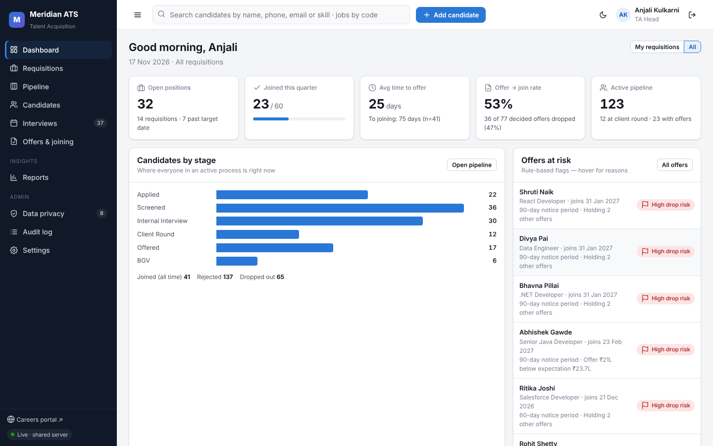
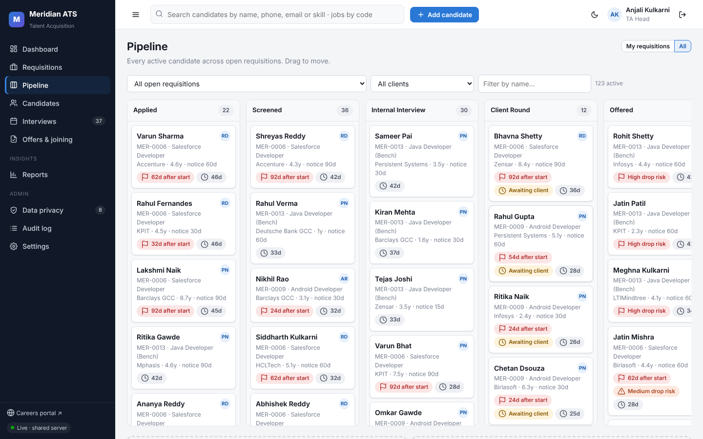
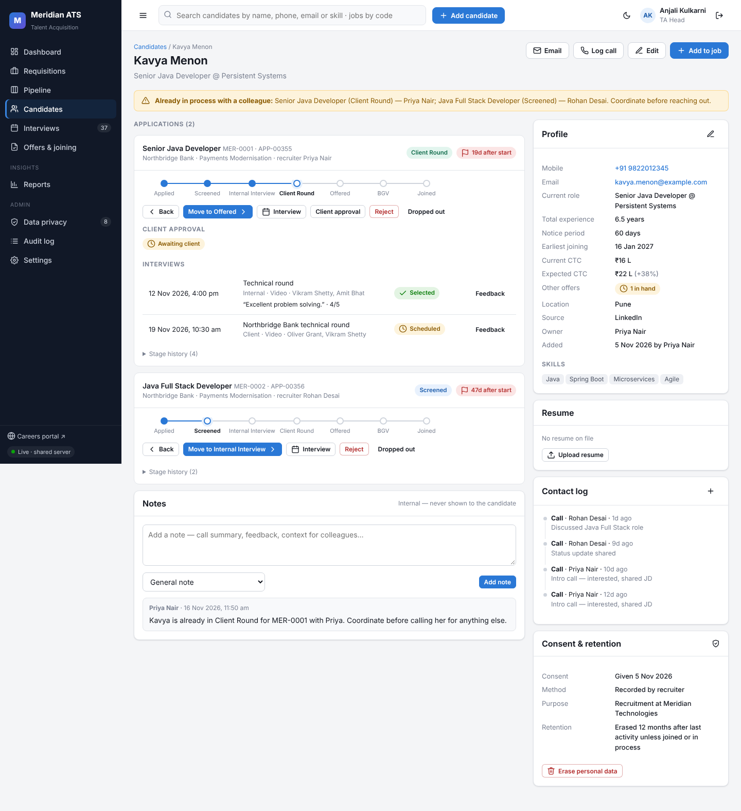
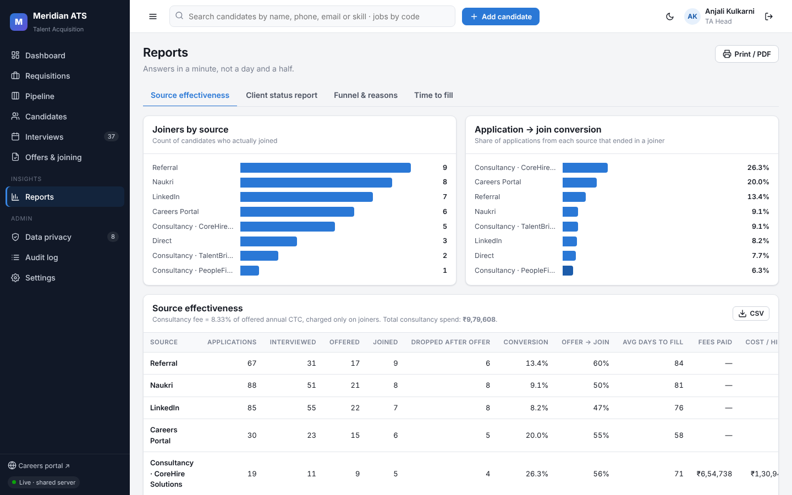
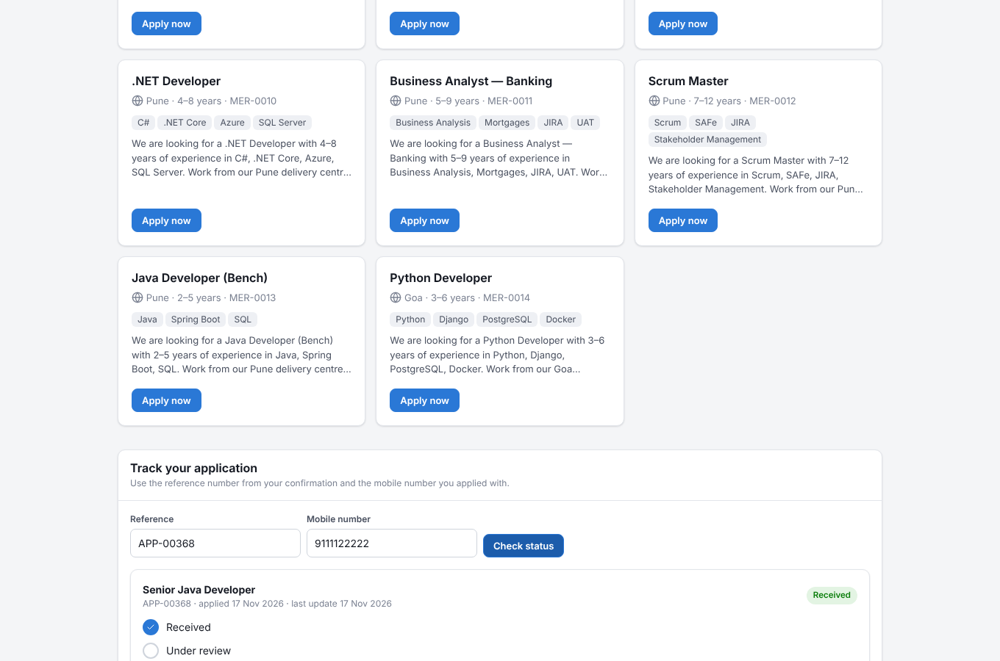

# Meridian ATS

An applicant tracking system built for an **Indian IT-services company**, not a product company. Every requisition is a billable slot on a client project with a hard start date. Candidates have to clear the client's own interview round, and notice periods of 30–90 days decide who can actually join. About a third of accepted offers never turn up.

The design work (problem, competitor research, owners, user stories, data model, MoSCoW and core loop) is in **[docs/PROTO.md](docs/PROTO.md)**.



## What it does

| Pain from the brief | What the system does |
|---|---|
| "Two recruiters called the same candidate on the same day" | **One shared record per person.** The phone number is the unique key (+91, spaces and a leading 0 are normalised). A **live duplicate warning** appears while you type, showing the owner, the last contact and active processes. Each candidate page has a banner when a colleague already has that candidate in process, plus a one-click contact log. |
| "Four versions of the Excel file" | One server, with live sync every 10 seconds. **CSV import** from the existing sheet skips duplicates. |
| "Status of a Java position took a day and a half" | **Client status report.** Pick a client and every requisition appears with stage counts, named candidates and availability dates. It is client-safe (no salaries, billing or notes) and can be copied as email text or printed to PDF. |
| "I feel we lose a third between offer and joining, but can't prove it" | The **offer → join rate** is calculated from real outcomes and shown on the dashboard. Drop-out reasons are captured. A **rule-based offer-drop risk flag** comes with the reasons behind it (not AI). |
| "Notice period decides everything" | Every candidate is checked against the project start date: **fits / N days late**. |
| "We can't hire without the client's approval" | The client approval is recorded (who and when) and **blocks the offer** until it exists. Bench roles skip this step. |
| "Which source actually works?" | Source effectiveness covers applications, interviews, offers, joins, conversion, offer→join rate, **consultancy fees (8.33% of annual CTC, joiners only)** and cost per hire. |
| "Every hire goes through BGV" | An offer is required before BGV, and BGV must be **Clear** before Joined. |
| "Candidate data isn't ours to keep forever" (DPDP Act) | **Consent** is recorded on every record. A **retention queue** erases personal data after N months of inactivity, while anonymous history keeps the metrics intact. Erasure on request is supported, and there is a full **audit log**. |
| Hiring managers must not see salaries | The server sends each role its own **redacted view**. Hiring managers see only shortlisted candidates on their own requisitions: no CTC, no phone or email, no billing rate. They get a mobile-friendly feedback form. |
| "Candidates should apply and check status" | A **careers portal** at `/careers.html` lets candidates apply with consent and get a reference number, then track their status with that reference and their mobile number. They see candidate-friendly stages only. |

Also included: a drag-and-drop **kanban pipeline** with forward and backward moves (each one timestamped), reject and drop-out **reason codes**, **interview scheduling** with panel, feedback and rating, **offer and BGV tracking**, **resume upload**, **skill-based search** and filters (notice period, experience, source, location, stage, owner), "**matching candidates already in your database**" for every requisition, **email templates** that open Outlook or Gmail and log the email, CSV export, a dashboard with time-to-offer and time-to-fill, recruiter workload, and dark mode.

**Won't have (v1):** payroll, onboarding, performance management, and anything AI-powered. Live Naukri/LinkedIn APIs need paid partner contracts. Server-side email sending needs SMTP and a domain. The reasons are in [docs/PROTO.md](docs/PROTO.md#o-one-slice).

| | |
|---|---|
|  |  |
|  |  |

## Roles

| Role | Sees | Can do |
|---|---|---|
| TA Head | Everything, including the audit log and the data-privacy queue | Everything, plus settings, users, clients, consultancies and erasure |
| Recruiter | All requisitions and candidates, so duplicates are visible | Add and edit candidates and requisitions, move stages, schedule interviews, make offers, run BGV, email |
| Hiring manager | Own requisitions, and only candidates at Internal Interview or later. No salary, contact details or billing. | Interview feedback, notes |
| Candidate | Own application status only | Apply, track |

## Run it

The app needs nothing but Node 18+. There are **zero dependencies**, so there's no `npm install`.

```bash
npm start
```

Open http://localhost:3000. The first run seeds fictional demo data. Sign in as `head@meridian.demo` with the password `meridian123`. Other accounts:

- recruiters: `priya@`, `rohan@`, `sneha@`, `arjun@`
- hiring managers: `vikram@`, `meera@`, `karan@`, `deepa@`, `sanjay@`

All of them use the `@meridian.demo` domain.

| Env var | Default | Meaning |
|---|---|---|
| `PORT` | 3000 | HTTP port |
| `DATA_DIR` | `./data` | Where `db.json` lives (back this folder up) |
| `SEED` | demo | Set to `none` to start empty with a single admin account |
| `ADMIN_EMAIL` / `ADMIN_PASSWORD` | — | The admin account used when `SEED=none` |
| `DEMO_PASSWORD` | meridian123 | The password for the seeded demo users |

To reset the demo data, run `npm run reset`. To run the business-rule tests, run `npm test`.

### Two modes, one codebase

- **Server mode** (`npm start`, Docker, Render, Railway or a VM) is the real system. Data is shared by the whole team, logins use hashed passwords, and role-based redaction is enforced on the server.
- **Demo mode** (any static host, such as **Vercel** or GitHub Pages) runs when no API is found. The same rules run in the browser against `localStorage`, and you pick a role without a password. It's good for showing the product. It is **not** a security boundary, and the data stays in that browser.

## Deploy

### Vercel (static demo, live URL in about a minute)

The repo includes `vercel.json`, which serves `public/` with no build step.

1. Go to [vercel.com/new](https://vercel.com/new) and import `mahadevrdalvi20-coder/ATS2`.
2. Leave every setting at its default. `vercel.json` already sets the output directory to `public`.
3. Click **Deploy**. You'll get a URL like `https://ats2-xxxx.vercel.app`. The careers portal is at `/careers`.

Every later push redeploys automatically. If the production branch isn't the one you push to, change it in Vercel under **Settings → Git → Production Branch**.

> Vercel's filesystem is ephemeral, so the Node server's `db.json` can't persist there. That's why Vercel runs demo mode. For the shared multi-recruiter system, use one of the options below. The next step would be moving the store to Postgres (for example Vercel Postgres or Supabase); the adapter in `public/js/store.js` is the only place that would change.

### Shared server (the real thing)

```bash
docker build -t meridian-ats .
```

```bash
docker run -p 3000:3000 -v ats-data:/data meridian-ats
```

On Render or Railway, use the start command `npm start` and attach a persistent disk with `DATA_DIR` pointing at it. At the brief's scale (40 open roles, 200 candidates a month, 3 years of history) a single JSON file stays at a few tens of MB.

## Project layout

```
public/            web app (no build step) – also what Vercel serves
  index.html       staff app
  careers.html     candidate portal
  js/core.js       ★ domain rules: stages, gates, permissions, redaction, risk, metrics, retention
  js/store.js      storage adapters (server API ↔ browser localStorage)
  js/app.js        staff UI (pages, kanban, modals)
  js/portal.js     careers portal UI
  js/seed.js       fictional demo data
server/server.js   zero-dependency Node HTTP server + JSON API + atomic JSON persistence
tests/             node:test suite for the business rules
docs/PROTO.md      problem, research, owners, user stories, data model, MoSCoW, what broke
```

All companies, people and phone numbers in the demo data are fictional.
